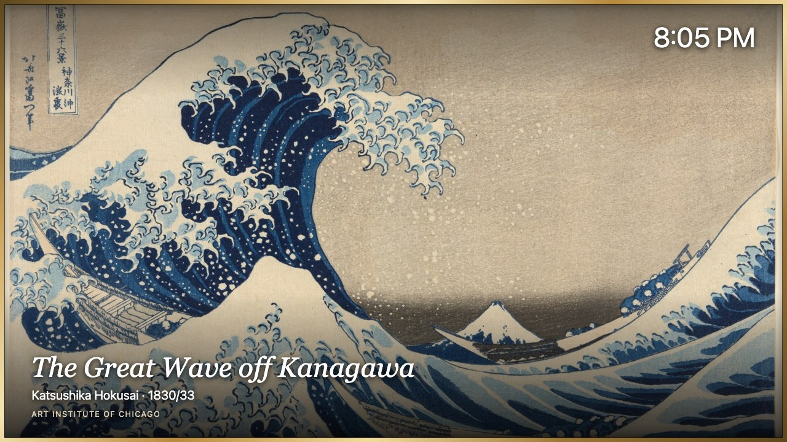

# Frame Pro Max

Turn your Samsung TV into a quiet art gallery. A gilded frame surrounds each work, paintings dissolve into one another, and the clock and artwork details fade after a few seconds. Fifteen public-domain works are bundled, so the gallery runs offline after installation.

**[Try the live browser demo](https://hbn6xkrdkm-a11y.github.io/frame-pro-max/)** · **[Install on a Samsung TV](docs/install.md)** · **[Download a release](https://github.com/hbn6xkrdkm-a11y/frame-pro-max/releases/latest)**



This is a standalone Tizen web app for Samsung TVs. It can sit alongside a custom TV launcher as an app or shortcut. Start it from the launcher or Samsung Apps, where your model lists sideloaded apps. It runs while it is on screen; it cannot take over idle time in other apps or replace Samsung's system screensaver. [Custom launcher integration →](docs/launcher.md)

| Remote | Action |
| --- | --- |
| Left / Right | Previous / next artwork |
| OK | Show title, artist, credit, and clock |
| OK again while the info is showing | Exit |
| Back | Exit immediately |

In a browser, use the arrow keys, Enter, Escape, or the on-screen controls. Select **Fullscreen** for the TV view.

## Already set up for Tizen sideloading?

With Tizen Studio, a Samsung TV certificate profile that includes your TV, and the TV listed as connected in `sdb devices`:

```sh
git clone https://github.com/hbn6xkrdkm-a11y/frame-pro-max.git
cd frame-pro-max
git switch --detach v1.0.1
scripts/install-tv.sh install 'YOUR_SAMSUNG_PROFILE' 'TV_IP:26101'
```

Replace both placeholders. If you need Developer Mode, certificates, Windows commands, or an update and uninstall workflow, follow the [full installation guide](docs/install.md). GitHub releases contain unsigned source. The installer builds and signs a local widget using your own profile.

## Work on the gallery

- [Agent handoff](AGENTS.md): where to start, invariants, tests, and what counts as TV verification.
- [Development and release workflows](docs/workflows.md): browser preview, changing the artwork, tests, build and publication.
- [Custom launcher integration](docs/launcher.md) and [troubleshooting](docs/troubleshooting.md).
- [Artwork credits and reuse](docs/artwork.md). The source code is [MIT licensed](LICENSE); the artwork has separate public-domain provenance.

The app declares Tizen 8.0 as its minimum. The slideshow behavior was previously exercised inside a launcher on a Samsung DU7200 running Tizen 9.0. This standalone release was built and signed with the Samsung SDK and checked in Chromium, including simulated Samsung API calls. Physical TV results for the standalone release have not been recorded yet.
